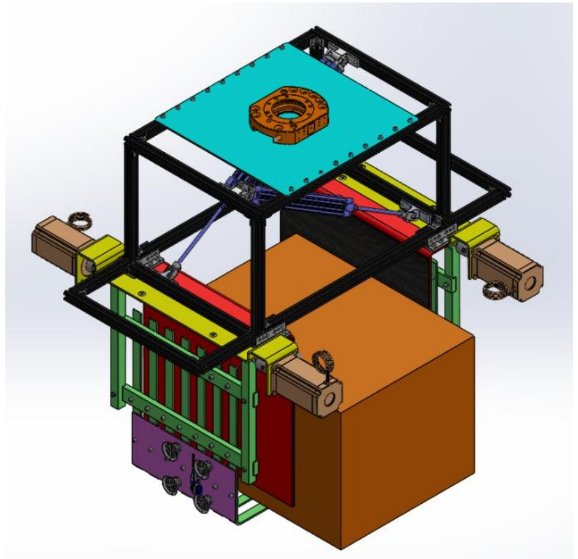
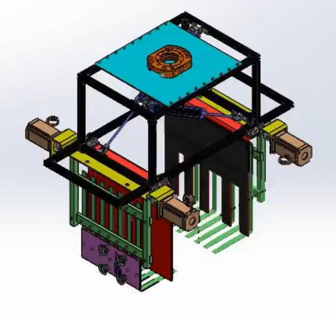

# Universal Gripper Concept for Humanoid Warehouse Robots

**Master's module Mechanical Design · TH Rosenheim, with TGW Logistics · Summer 2025**
Team (Group G): Agney Jadav, Manu Mathew, Milind Patil, Swara Pimprikar, Samir Solaiman · Supervisors: Prof. Dr. Ihab Ragai, Prof. Dr.-Ing. Michael Wagner

[English](#english) · [Deutsch](#deutsch)

---

## English

**Status:** concept and CAD design with a cost estimate. No prototype was built or tested.

### The problem
Warehouse grippers are usually made for one kind of item, so handling mixed goods means changing tools. TGW's brief asked for one end-effector for a humanoid robot that can handle cartons, bottles, cans, sachets and plastic bags, weighing 0.5 to 30 kg and measuring up to 600 × 400 × 450 mm, across picking, palletising, depalletising and de-traying.

### How we got to the design
1. **Requirements and functions:** turned TGW's brief into a requirements list and broke the task into functions, from detecting the item's state to placing and releasing it.
2. **Market survey:** compared vacuum, mechanical, magnetic, soft, adaptive and fork-style grippers.
3. **Morphological box:** combined solutions for each sub-function into five concepts.
4. **Evaluation:** rated the concepts with pairwise comparison, weighted points and technical and economic valence.

Concept 3, a parallel jaw gripper with a double-sided fork, was selected. It did not score highest technically (0.67, against 0.79 for the two best concepts), but it had the best economic score (0.84) at an estimated €2,512, against an acceptable cost of €3,000.

### The final design

- **Two parallel plates** with rubber pads, moved by pneumatic cylinders, hold the item from the sides.
- **Rotating support forks**, driven by four stepper motors, carry the load from below. The pneumatic plates alone were not enough for safe transport at 30 kg.
- **Cut-outs in one plate** give bottles and cans three-point contact.
- **A servo-driven retractable blade** cuts plastic wrapping and stays inside the structure when not in use.
- **Four vacuum cups** hold wrapping in tension during cutting and separate tightly stacked boxes so the plates can get in.
- **The frame** uses aluminium extrusions and sheet metal to keep weight and cost down.

### Trade-offs
Handling this much variety makes the gripper larger and more complex, and it is not ideal for very pressure-sensitive items. Next steps would be making it smaller, simplifying the actuation and adapting it for fragile goods.

---

## Deutsch

**Stand:** Konzept und CAD-Konstruktion mit Kostenschätzung. Es wurde kein Prototyp gebaut oder getestet.

### Die Aufgabe
Lagergreifer sind meist für eine Art von Artikel ausgelegt, gemischte Ware erfordert daher einen Werkzeugwechsel. TGW suchte einen einzigen Endeffektor für einen humanoiden Roboter, der Kartons, Flaschen, Dosen, Beutel und Kunststofftüten von 0,5 bis 30 kg und bis zu 600 × 400 × 450 mm handhabt, und zwar beim Kommissionieren, Palettieren, Depalettieren und De-Traying.

### Der Weg zur Konstruktion
1. **Anforderungen und Funktionen:** Aus der Vorgabe von TGW eine Anforderungsliste erstellt und die Aufgabe in Funktionen zerlegt, vom Erkennen des Artikelzustands bis zum Ablegen und Lösen.
2. **Marktrecherche:** Vakuum-, mechanische, magnetische, weiche, adaptive und Gabelgreifer verglichen.
3. **Morphologischer Kasten:** Lösungen je Teilfunktion zu fünf Konzepten kombiniert.
4. **Bewertung:** Konzepte mit Paarvergleich, gewichteter Punktbewertung sowie technischer und wirtschaftlicher Wertigkeit bewertet.

Ausgewählt wurde Konzept 3, ein Parallelbackengreifer mit doppelseitiger Gabel. Technisch lag es nicht vorn (0,67 gegenüber 0,79 bei den beiden besten Konzepten), wirtschaftlich aber an der Spitze (0,84) mit geschätzten 2.512 € bei zulässigen Kosten von 3.000 €.

### Die finale Konstruktion
- **Zwei parallele Platten** mit Gummiauflage, bewegt von Pneumatikzylindern, halten den Artikel seitlich.
- **Drehbare Stützgabeln**, angetrieben von vier Schrittmotoren, tragen die Last von unten. Die pneumatischen Platten allein reichten für einen sicheren Transport bei 30 kg nicht aus.
- **Aussparungen in einer Platte** geben Flaschen und Dosen eine Dreipunktauflage.
- **Eine servogetriebene, einziehbare Klinge** schneidet Kunststofffolie und bleibt außer Betrieb im Gehäuse.
- **Vier Vakuumsauger** spannen die Folie beim Schneiden und trennen eng gestapelte Kartons, damit die Platten greifen können.
- **Der Rahmen** besteht aus Aluminiumprofilen und Blech, um Gewicht und Kosten zu senken.

### Zielkonflikte
Die große Artikelvielfalt macht den Greifer größer und komplexer, und für sehr druckempfindliche Artikel ist er nicht ideal. Nächste Schritte wären eine kleinere Bauform, eine einfachere Aktorik und die Anpassung an empfindliche Ware.
